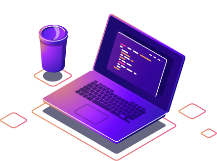

<h1 align="center">👋 Felipe Figueiredo Amorim</h1>

<em>Desenvolvedor Full Stack com foco em C#, .NET, Angular e Engenharia de Dados.</em>

🇧🇷 Português | 🇺🇸 <a href="README.en.md">English</a>

 

<a href="#sobre">Sobre</a> • <a href="#tecnologias">Tecnologias</a> • <a href="#como-rodar">Como rodar</a> • <a href="#licenca">Licença</a> • <a href="#autor">Autor</a>

---

<h2 id="sobre">💻 Sobre Mim</h2>

Sou formado em desenvolvimento de sistemas e minha trajetória profissional começou como projetista cadista. Com o tempo, migrei para a área de TI, atuando com suporte técnico (N1 e N2), manutenção de hardware e servidores, gerenciamento de Active Directory (AD) e administração de backups.

Meu primeiro contato com o desenvolvimento veio através do front-end, com HTML e CSS. A paixão só cresceu quando descobri o poder do JavaScript, o que me levou a explorar frameworks e aprofundar no back-end com .NET e C#.

Hoje atuo tanto no front quanto no back-end, focando em criar soluções eficientes, responsivas e escaláveis.

### 🌐 Redes Sociais

  
  

## 🛠️ Tecnologias

### 🧠 Back-End

  
    
  

### 🎨 Front-End

  
  
  
  
  
  
  

### 🗄️ Banco de Dados

  
  
  
  

### ☁️ Infraestrutura e Virtualização

  
  
  

## 🔗 Repositórios relacionados

- [ListiFy.Api](https://github.com/Felipe-Amorim-Dev/ListiFy.Api) — API ASP.NET Core e SQL Server
- [personal-finance-identity-service](https://github.com/Felipe-Amorim-Dev/personal-finance-identity-service) — Identidade e autenticação em .NET 9
- [CAD-Viewer](https://github.com/Felipe-Amorim-Dev/CAD-Viewer) — Web Component 3D em TypeScript
- [WindowsIntegrityGuard](https://github.com/Felipe-Amorim-Dev/WindowsIntegrityGuard) — Verificação de integridade no Windows

## 🧭 Portfólio por especialidade

Os repositórios estão organizados para apresentar decisões de desenvolvimento e arquitetura em diferentes tipos de aplicação.

| Especialidade | Projeto | Aspectos técnicos |
| --- | --- | --- |
| Microsserviços | [Personal Finance Identity Service](https://github.com/Felipe-Amorim-Dev/personal-finance-identity-service) | Separação Host/API/Application/Domain/Infrastructure, EF Core, MySQL, JWT e outbox |
| APIs e integração | [API Gateway](https://github.com/Felipe-Amorim-Dev/APIGateway) | Proxy reverso com YARP, autenticação e roteamento |
| Full Stack | [ListiFy](https://github.com/Felipe-Amorim-Dev/ListiFy.Api) | Back-end .NET, SQL Server e front-end Angular |
| Persistência NoSQL | [ShortMyUrl](https://github.com/Felipe-Amorim-Dev/ShortMyUrl-DOTNET) | Encurtamento de links, MongoDB e Docker Compose |
| Bibliotecas | [CAD Viewer](https://github.com/Felipe-Amorim-Dev/CAD-Viewer) | Web Components, Three.js, API pública de visualização 3D |
| Aplicações Windows | [Windows Integrity Guard](https://github.com/Felipe-Amorim-Dev/WindowsIntegrityGuard) | .NET Worker Service, WPF, Named Pipes e fluxo SFC/DISM |

### Organização dos projetos

Os sistemas com front-end e back-end estão divididos em repositórios próprios, com documentação de integração entre as partes. O Windows Integrity Guard utiliza um repositório agregador com submódulos Git; o Personal Finance Platform reúne arquitetura e serviços em evolução. Cada repositório descreve suas camadas, componentes, modo de execução e tecnologias efetivamente utilizadas.

Meu trabalho em sistemas corporativos é independente destes projetos públicos e não inclui publicação de código ou informações confidenciais.

## 📄 Licença

Distribuído sob a [licença MIT](LICENSE).

## 👤 Autor

**Felipe Figueiredo Amorim** — Desenvolvedor Full Stack.

 

<strong>Obrigado por visitar! / Thanks for visiting!</strong>

